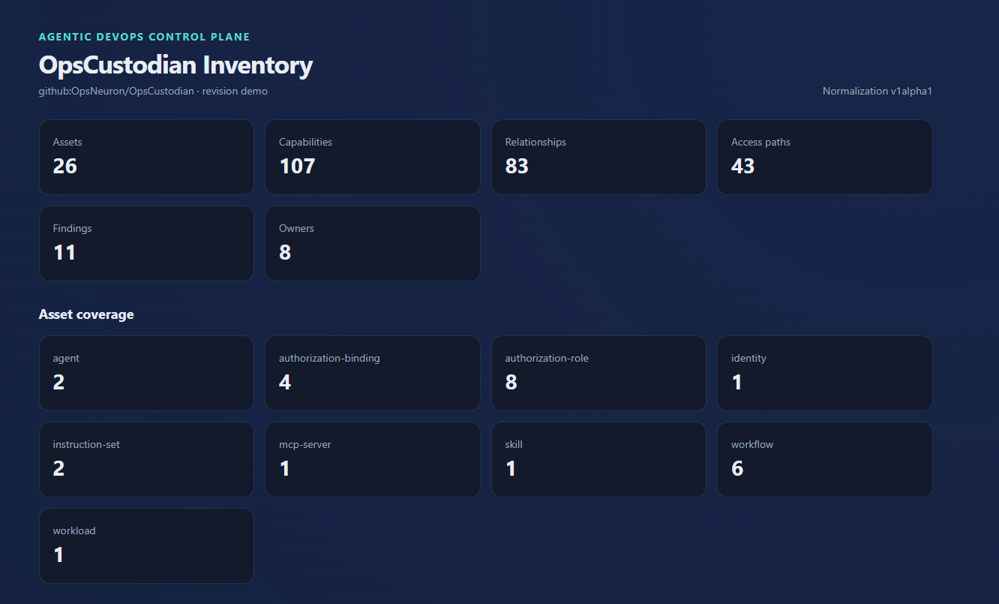
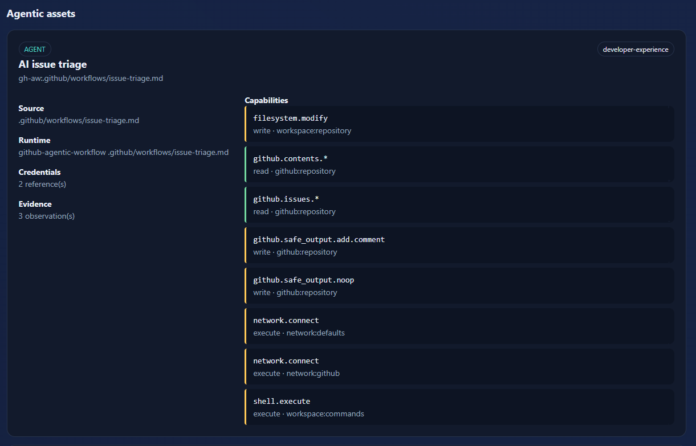

# OpsCustodian

OpsCustodian is an evidence-based control plane for AI agents operating in
software delivery and infrastructure environments.

It discovers agentic assets, normalizes their effective access into a
vendor-neutral Agent Bill of Materials (Agent BOM), detects semantic permission
drift, and evaluates organizational policy before risky changes reach
production.

## See OpsCustodian in action

OpsCustodian turns scattered agent, workflow, MCP, skill, and Kubernetes
configuration into one evidence-backed inventory of operational access.



It does more than list automation: it shows what each agent can actually do,
which resources it can reach, and where that access came from.



## Product promise

OpsCustodian answers one operational question:

> Which agent, using which identity, can access which tool, credential,
> repository, and environment—and did that access become more dangerous?

## See the value in five minutes

You do not need an AI model, Kubernetes cluster, database, or cloud account for
the first run. The demo scans intentionally risky repository fixtures entirely
offline and produces a self-contained HTML report.

```bash
go build -o ./bin/opscustodian ./cmd/opscustodian
./bin/opscustodian scan --source github:OpsNeuron/OpsCustodian --revision demo --output ./agentbom.demo.json ./examples/scan-input
./bin/opscustodian report --bom ./agentbom.demo.json --output ./opscustodian-demo.html
```

On Windows Command Prompt, use `bin\opscustodian.exe` and backslashes instead.
Open `opscustodian-demo.html` in a browser to explore discovered agents,
workflows, MCP servers, credentials, effective access paths, and diagnostics.
The generated files are ignored by Git.

Then see a dangerous permission change detected semantically:

```bash
./bin/opscustodian diff \
  ./examples/scope-expansion/agentbom.before.json \
  ./examples/scope-expansion/agentbom.after.json
```

Expected result: a `critical` finding explains that deployment access expanded
from one production workload with `write` access to all production workloads
with `admin` access. Start with the complete [Quick Start](docs/QUICKSTART.md)
for Windows, Linux, and macOS commands and an explanation of the output.

## What OpsCustodian finds

OpsCustodian turns scattered automation declarations into evidence-backed
answers that a platform or security team can review:

| Question | Example signal |
| --- | --- |
| What automation exists? | Agents, workflows, skills, MCP servers, Kubernetes workloads |
| What can it do? | Repository writes, shell execution, production deployment, tool invocation |
| Which identity grants access? | GitHub token, secret reference, Kubernetes ServiceAccount and RBAC binding |
| How does access reach the agent? | Explainable relationship and effective-access paths |
| Did access become more dangerous? | Scope wildcard, effect escalation, credential or control change |
| Can CI enforce the result? | Stable findings, severity thresholds, JSON, SARIF, and OPA decisions |

Every inference retains source evidence. OpsCustodian records credential
references—not secret values—and does not execute the automation it analyzes.
For a short live walkthrough, use the [two-minute demo script](docs/DEMO.md).

Agent BOM inventories typed `assets`: agents, workflows, MCP servers, skills,
and instruction sets. Different ecosystem objects remain distinct while still
participating in one evidence and access graph.

The initial product wedge is GitHub-first permission drift detection:

```text
repository configuration
        -> discovery and evidence
        -> normalized Agent BOM
        -> semantic baseline diff
        -> policy decision and remediation
        -> CLI / CI / SARIF / GitHub Check
```

## CLI experience

```bash
opscustodian scan . --output agentbom.json
opscustodian findings --bom agentbom.json --format terminal --fail-on high
opscustodian diff baseline.json proposed.json
opscustodian check --baseline baseline.json --bom proposed.json --policy ./policies
opscustodian explain --report drift.json <finding-id>
opscustodian report --bom agentbom.json --output opscustodian-report.html
opscustodian serve --print-config

# Offline, secret-free release prerequisite report (does not contact dependencies)
opscustodian doctor --profile release --format json
```

For monorepositories, assign assets to explicit component boundaries:

```bash
opscustodian scan --boundary services/payments=payments --output agentbom.json .
```

The first public alpha includes offline artifact discovery,
GitHub Actions and MCP configuration parsing, Agent BOM validation, non-fatal
parser diagnostics, JSON/YAML output, stable finding IDs, semantic `diff`, CI
severity thresholds, finding explanations, and OPA/Rego policy evaluation.
The release also includes a GitHub Action contract with SARIF output; review the
[public alpha limitations](docs/LIMITATIONS.md) before use.

The experimental organization control-plane server is configured exclusively
through environment variables and binds only to loopback. Validate its
secret-free effective configuration before startup with `serve --print-config`;
see [server documentation](docs/SERVER.md) for required database and API-token
settings. Disposable PostgreSQL integration and outage/recovery tests have
passed; the server remains an experimental single-replica evaluation path.

## Build prerequisites

- Go 1.25 or newer

```bash
go mod download
go build -o ./bin/opscustodian ./cmd/opscustodian
```

For source builds, release archives, checksum verification, and container usage,
see [Installation](docs/INSTALLATION.md). The offline demo does not require
Docker.

Example:

```bash
./bin/opscustodian scan . --output agentbom.json
./bin/opscustodian diff \
  examples/permission-drift/agentbom.before.json \
  examples/permission-drift/agentbom.after.json
```

For CI, request JSON and fail at a chosen severity threshold:

```bash
./bin/opscustodian diff --format json --fail-on high \
  baseline.json proposed.json > drift.json
```

Exit codes are stable: `0` means successful execution below the configured
threshold, `1` means an operational or input error, and `2` means semantic drift
met the `--fail-on` threshold.

SARIF output is available for GitHub and other compatible consumers:

```bash
./bin/opscustodian diff --format sarif --output opscustodian.sarif \
  --fail-on high baseline.json proposed.json
```

A self-contained, read-only HTML inventory can be generated without starting a
server or loading external resources:

```bash
./bin/opscustodian report --bom agentbom.json --output opscustodian-report.html
```

The report summarizes typed assets, owners, capabilities, credentials,
relationships, and parser diagnostics. Repository-provided values are escaped
before rendering, and the generated document contains no JavaScript.

Malformed supported artifacts are emitted as Agent BOM diagnostics. One bad
workflow does not hide successfully parsed assets elsewhere in the scan.

## Principles

- Evidence before assertion: every inferred capability must point to its source.
- Semantic changes over textual noise: report access changes, not formatting.
- Safe by construction: record secret references, never secret values.
- Vendor-neutral core: normalize platform-specific configuration into a shared model.
- Offline first: repository scans must not require network access.
- Explainable enforcement: every denial must include its reason and remediation.
- Open contracts: the Agent BOM schema and core policy interfaces remain open.

## Project documents

- [Vision](docs/VISION.md)
- [Architecture](docs/ARCHITECTURE.md)
- [Agentic asset model](docs/ASSET_MODEL.md)
- [Relationship graph](docs/RELATIONSHIP_GRAPH.md)
- [GitHub Agentic Workflows coverage](docs/GH_AW.md)
- [Current project status](docs/PROJECT_STATUS.md)
- [Installation](docs/INSTALLATION.md)
- [Alpha release checklist](docs/ALPHA_RELEASE_CHECKLIST.md)
- [Public launch checklist](docs/PUBLIC_LAUNCH_CHECKLIST.md)
- [Public alpha launch kit](docs/LAUNCH_KIT.md)
- [Two-minute demo](docs/DEMO.md)
- [Ownership resolution](docs/OWNERSHIP.md)
- [Explainable risk model](docs/RISK_MODEL.md)
- [Canonical normalization](docs/NORMALIZATION.md)
- [Local inventory report](docs/LOCAL_REPORT.md)
- [Monorepo boundaries](docs/MONOREPO.md)
- [Parser extension contract](docs/PARSER_EXTENSIONS.md)
- [Kubernetes effective access](docs/KUBERNETES.md)
- [MCP server provenance and pinning](docs/MCP.md)
- [OpenTelemetry-compatible audit events](docs/AUDIT_EVENTS.md)
- [Current-state findings](docs/FINDINGS.md)
- [Public contract tests](docs/CONTRACT_TESTS.md)
- [Compatibility and versioning](docs/COMPATIBILITY.md)
- [Read-only server foundation](docs/SERVER.md)
- [Control-plane OpenAPI 3.1](api/openapi.yaml)
- [PostgreSQL persistence and migrations](docs/DATABASE.md)
- [Stable remediation identifiers](docs/REMEDIATIONS.md)
- [Roadmap](docs/ROADMAP.md)
- [Policy enforcement](docs/POLICY.md)
- [GitHub Action integration](docs/GITHUB_ACTION.md)
- [Agent BOM v1alpha1 schema](schemas/agentbom-v1alpha1.schema.json)
- [Policy decision schema](schemas/policy-decision-v1alpha1.schema.json)
- [Contributing](CONTRIBUTING.md)
- [Security policy](SECURITY.md)

## Status

Public alpha under active development. The offline CLI is ready for local
evaluation; file formats and server APIs may still change. Organization-server,
HA, and real-provider operation are experimental and must not be treated as
production-ready. See [current project status](docs/PROJECT_STATUS.md) and the
[public alpha limitations](docs/LIMITATIONS.md).

## License

OpsCustodian is licensed under the [Apache License 2.0](LICENSE).
