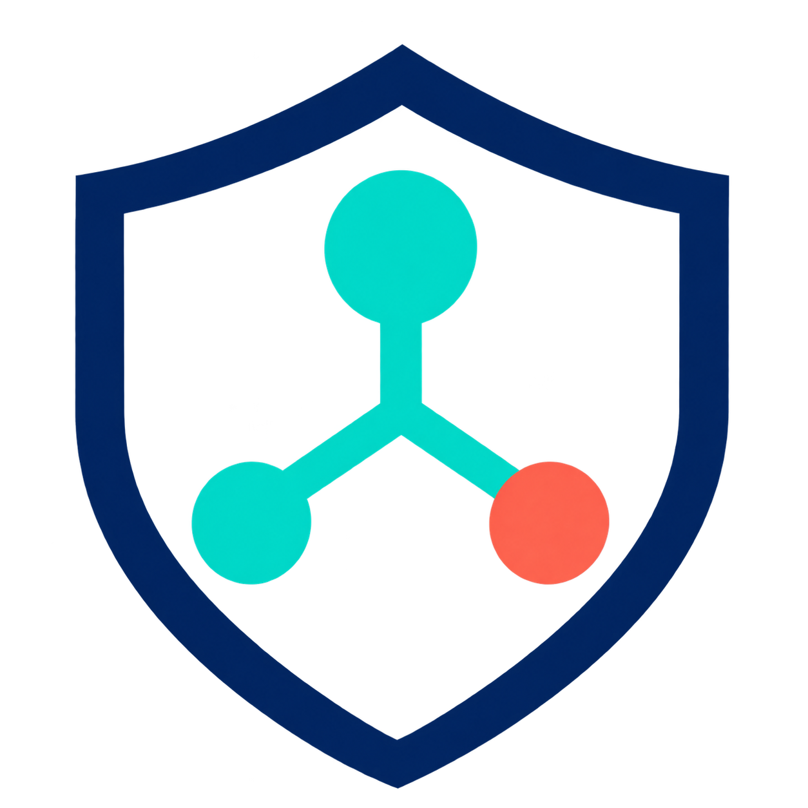
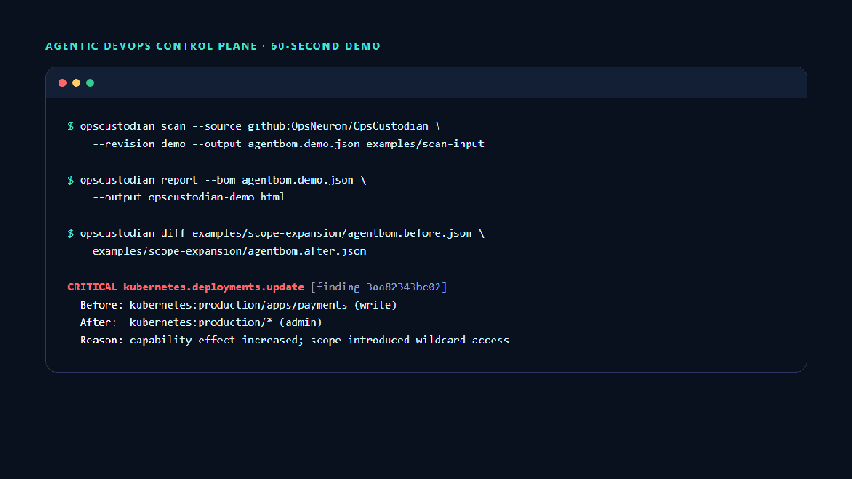

<div align="center">
  
  <h1>OpsCustodian</h1>
  <p><strong>Evidence-based control for agentic DevOps.</strong></p>
  <p>
    Discover what agents can reach, explain how they got access, and stop
    dangerous permission drift before production.
  </p>
  <p>
    <a href="https://github.com/OpsNeuron/OpsCustodian/actions/workflows/ci.yml"></a>
    <a href="https://github.com/OpsNeuron/OpsCustodian/releases"></a>
    <a href="LICENSE"></a>
    
    
  </p>
  <p>
    <a href="docs/QUICKSTART.md">Quick start</a> ·
    <a href="docs/DEMO.md">Two-minute demo</a> ·
    <a href="docs/ARCHITECTURE.md">Architecture</a> ·
    <a href="docs/BETA_SUPPORT_MATRIX.md">Support matrix</a> ·
    <a href="CONTRIBUTING.md">Contributing</a>
  </p>
</div>

---

OpsCustodian is an evidence-based control plane for AI agents operating in
software delivery and infrastructure environments. It discovers agentic
assets, normalizes their effective access into a vendor-neutral Agent Bill of
Materials (Agent BOM), detects semantic permission drift, and evaluates
organizational policy before risky changes reach production.

> **Release status:** the offline CLI is a first-beta release candidate. The
> control-plane server is an experimental, single-replica reference. Review the
> [support matrix](docs/BETA_SUPPORT_MATRIX.md) and
> [current limitations](docs/LIMITATIONS.md) before operational use.

## Why OpsCustodian

| Inventory | Explain | Detect | Enforce |
| --- | --- | --- | --- |
| Find agents, workflows, skills, MCP servers, identities, and Kubernetes workloads. | Trace effective access back to source evidence, credentials, and relationships. | Identify semantic permission drift instead of noisy text changes. | Apply severity thresholds, OPA policy, SARIF, and CI decisions. |

OpsCustodian answers one operational question:

> **Which agent, using which identity, can access which tool, credential,
> repository, and environment—and did that access become more dangerous?**

```text
Repository configuration
        ↓
Discovery and source evidence
        ↓
Normalized Agent BOM and access graph
        ↓
Semantic drift and policy decision
        ↓
CLI · CI · SARIF · GitHub Check · HTML report
```

## See OpsCustodian in action

OpsCustodian turns scattered agent, workflow, MCP, skill, and Kubernetes
configuration into one evidence-backed inventory of operational access.




It does more than list automation: it shows what each agent can actually do,
which resources it can reach, and where that access came from.


## Try it in five minutes

You do not need an AI model, Kubernetes cluster, database, or cloud account for
the first run. The demo scans intentionally risky repository fixtures entirely
offline and produces a self-contained HTML report.

```bash
go build -o ./bin/opscustodian ./cmd/opscustodian
./bin/opscustodian scan --source github:OpsNeuron/OpsCustodian --revision demo --output ./agentbom.demo.json ./examples/scan-input
./bin/opscustodian report --bom ./agentbom.demo.json --output ./opscustodian-demo.html
```

On Windows Command Prompt, use `bin\opscustodian.exe` and backslashes instead.
Open `opscustodian-demo.html` in a browser to explore discovered agents,
workflows, MCP servers, credentials, effective access paths, and diagnostics.
The generated files are ignored by Git.

Then see a dangerous permission change detected semantically:

```bash
./bin/opscustodian diff \
  ./examples/scope-expansion/agentbom.before.json \
  ./examples/scope-expansion/agentbom.after.json
```

Expected result: a `critical` finding explains that deployment access expanded
from one production workload with `write` access to all production workloads
with `admin` access. Start with the complete [Quick Start](docs/QUICKSTART.md)
for Windows, Linux, and macOS commands and an explanation of the output.

## What OpsCustodian finds

OpsCustodian turns scattered automation declarations into evidence-backed
answers that a platform or security team can review:

| Question | Example signal |
| --- | --- |
| What automation exists? | Agents, workflows, skills, MCP servers, Kubernetes workloads |
| What can it do? | Repository writes, shell execution, production deployment, tool invocation |
| Which identity grants access? | GitHub token, secret reference, Kubernetes ServiceAccount and RBAC binding |
| How does access reach the agent? | Explainable relationship and effective-access paths |
| Did access become more dangerous? | Scope wildcard, effect escalation, credential or control change |
| Can CI enforce the result? | Stable findings, severity thresholds, JSON, SARIF, and OPA decisions |

Every inference retains source evidence. OpsCustodian records credential
references—not secret values—and does not execute the automation it analyzes.
For a short live walkthrough, use the [two-minute demo script](docs/DEMO.md).

Agent BOM inventories typed `assets`: agents, workflows, MCP servers, skills,
and instruction sets. Different ecosystem objects remain distinct while still
participating in one evidence and access graph.

The initial product wedge is GitHub-first permission drift detection, built on
provider-neutral contracts that can grow without collapsing different asset
types into one generic automation record.

## CLI experience

```bash
opscustodian scan . --output agentbom.json
opscustodian findings --bom agentbom.json --format terminal --fail-on high
opscustodian diff baseline.json proposed.json
opscustodian check --baseline baseline.json --bom proposed.json --policy ./policies
opscustodian explain --report drift.json <finding-id>
opscustodian report --bom agentbom.json --output opscustodian-report.html
opscustodian serve --print-config

# Offline, secret-free release prerequisite report (does not contact dependencies)
opscustodian doctor --profile release --format json
```

For monorepositories, assign assets to explicit component boundaries:

```bash
opscustodian scan --boundary services/payments=payments --output agentbom.json .
```

The first-beta candidate includes offline artifact discovery, GitHub Actions,
MCP, agent, and Kubernetes configuration parsing, Agent BOM validation,
evidence-backed access paths and findings, semantic `diff`, CI severity
thresholds, OPA/Rego policy evaluation, SARIF output, and a deliberately narrow
single-replica control-plane reference. Review the
[beta support matrix](docs/BETA_SUPPORT_MATRIX.md) and
[current limitations](docs/LIMITATIONS.md) before use.

The experimental organization control-plane server is configured exclusively
through environment variables and binds only to loopback. Validate its
secret-free effective configuration before startup with `serve --print-config`;
see [server documentation](docs/SERVER.md) for required database and API-token
settings. Disposable PostgreSQL integration and outage/recovery tests have
passed, including an isolated logical backup/restore check; the server remains
an experimental single-replica evaluation path. See the
[backup and restore runbook](docs/BACKUP_RESTORE.md).
Database upgrades are forward-only and fail closed on unknown versions; follow
the [control-plane upgrade runbook](docs/UPGRADES.md).

## Build prerequisites

- Go 1.26.10 or newer supported patch release

```bash
go mod download
go build -o ./bin/opscustodian ./cmd/opscustodian
```

For source builds, release archives, checksum verification, and container usage,
see [Installation](docs/INSTALLATION.md). The offline demo does not require
Docker.

Example:

```bash
./bin/opscustodian scan . --output agentbom.json
./bin/opscustodian diff \
  examples/permission-drift/agentbom.before.json \
  examples/permission-drift/agentbom.after.json
```

For CI, request JSON and fail at a chosen severity threshold:

```bash
./bin/opscustodian diff --format json --fail-on high \
  baseline.json proposed.json > drift.json
```

Exit codes are stable: `0` means successful execution below the configured
threshold, `1` means an operational or input error, and `2` means semantic drift
met the `--fail-on` threshold.

SARIF output is available for GitHub and other compatible consumers:

```bash
./bin/opscustodian diff --format sarif --output opscustodian.sarif \
  --fail-on high baseline.json proposed.json
```

A self-contained, read-only HTML inventory can be generated without starting a
server or loading external resources:

```bash
./bin/opscustodian report --bom agentbom.json --output opscustodian-report.html
```

The report summarizes typed assets, owners, capabilities, credentials,
relationships, and parser diagnostics. Repository-provided values are escaped
before rendering, and the generated document contains no JavaScript.

Malformed supported artifacts are emitted as Agent BOM diagnostics. One bad
workflow does not hide successfully parsed assets elsewhere in the scan.

## Principles

- Evidence before assertion: every inferred capability must point to its source.
- Semantic changes over textual noise: report access changes, not formatting.
- Safe by construction: record secret references, never secret values.
- Vendor-neutral core: normalize platform-specific configuration into a shared model.
- Offline first: repository scans must not require network access.
- Explainable enforcement: every denial must include its reason and remediation.
- Open contracts: the Agent BOM schema and core policy interfaces remain open.

## Documentation map

| Start here | Model and analysis | Security and policy | Operations and integration |
| --- | --- | --- | --- |
| [Quick start](docs/QUICKSTART.md)<br>[Installation](docs/INSTALLATION.md)<br>[Two-minute demo](docs/DEMO.md)<br>[Current status](docs/PROJECT_STATUS.md)<br>[Roadmap](docs/ROADMAP.md) | [Architecture](docs/ARCHITECTURE.md)<br>[Agentic asset model](docs/ASSET_MODEL.md)<br>[Relationship graph](docs/RELATIONSHIP_GRAPH.md)<br>[Normalization](docs/NORMALIZATION.md)<br>[Findings](docs/FINDINGS.md)<br>[Risk model](docs/RISK_MODEL.md) | [Policy enforcement](docs/POLICY.md)<br>[Threat model](docs/THREAT_MODEL.md)<br>[Remediations](docs/REMEDIATIONS.md)<br>[Contract tests](docs/CONTRACT_TESTS.md)<br>[Security policy](SECURITY.md) | [Server](docs/SERVER.md)<br>[OpenAPI 3.1](api/openapi.yaml)<br>[Database](docs/DATABASE.md)<br>[Upgrades](docs/UPGRADES.md)<br>[Backup and restore](docs/BACKUP_RESTORE.md)<br>[GitHub Action](docs/GITHUB_ACTION.md) |

### Ecosystem coverage

- [GitHub Agentic Workflows](docs/GH_AW.md)
- [Kubernetes effective access](docs/KUBERNETES.md)
- [MCP server provenance and pinning](docs/MCP.md)
- [Ownership resolution](docs/OWNERSHIP.md)
- [Monorepo boundaries](docs/MONOREPO.md)
- [Parser extension contract](docs/PARSER_EXTENSIONS.md)
- [OpenTelemetry-compatible audit events](docs/AUDIT_EVENTS.md)
- [Performance evidence](docs/PERFORMANCE.md)

### Contracts and release evidence

- [Agent BOM v1alpha1 schema](schemas/agentbom-v1alpha1.schema.json)
- [Policy decision v1alpha1 schema](schemas/policy-decision-v1alpha1.schema.json)
- [Compatibility and versioning](docs/COMPATIBILITY.md)
- [Beta support matrix](docs/BETA_SUPPORT_MATRIX.md)
- [Beta release readiness checklist](docs/BETA_RELEASE_CHECKLIST.md)
- [First-beta contract freeze](docs/BETA_CONTRACT_FREEZE.md)
- [First-beta representative Finding review](docs/BETA_FINDING_REVIEW.md)
- [First-beta release notes](docs/releases/v0.6.0-beta.1.md)

<details>
<summary>Historical alpha release evidence</summary>

- [Alpha release checklist](docs/ALPHA_RELEASE_CHECKLIST.md)
- [Public alpha launch kit](docs/LAUNCH_KIT.md)

</details>

For community and project governance, see [Contributing](CONTRIBUTING.md), the
[Code of conduct](CODE_OF_CONDUCT.md), and [Support](SUPPORT.md).

## Status

First-beta release candidate under validation. The offline CLI is ready for
local evaluation, while the supported server reference remains single-replica
and deliberately narrow. Public contracts remain pre-v1 and may still change.
HA and unsupported provider modes must not be treated as production-ready. See
[current project status](docs/PROJECT_STATUS.md), the
[beta support matrix](docs/BETA_SUPPORT_MATRIX.md), and
[current limitations](docs/LIMITATIONS.md).

## Creator and maintainer

OpsCustodian was created and is maintained by
**Mohammadreza Tahari (محمدرضا طهری)**
([@OpsNeuron](https://github.com/OpsNeuron)), a DevOps Engineer interested in
applying AI to infrastructure, software delivery, and operational safety.

## License

OpsCustodian is licensed under the [Apache License 2.0](LICENSE).
