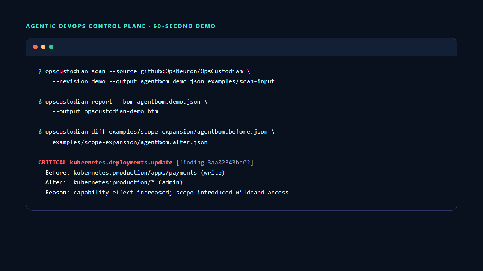
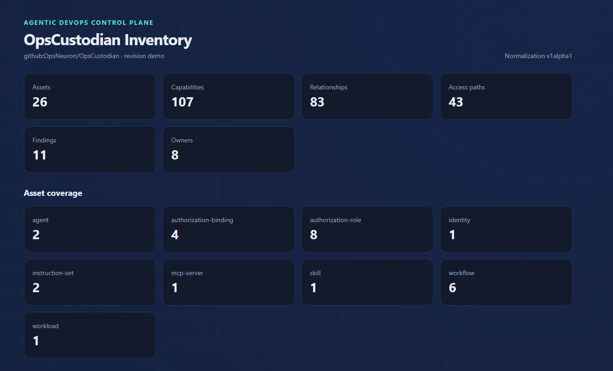
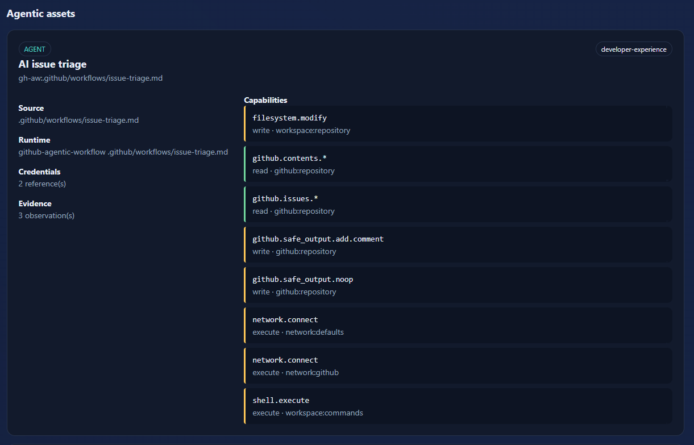

# Public alpha launch kit

This kit keeps the first OpsCustodian announcement focused on the verified
offline workflow. Link to the tested
[`v0.5.0-alpha` release](https://github.com/OpsNeuron/OpsCustodian/releases/tag/v0.5.0-alpha),
not an unversioned source snapshot.

## Core message

AI agents and automated workflows increasingly operate deployment, repository,
tool, and Kubernetes access. That access is usually scattered across workflow
files, MCP configuration, identities, secrets references, and imported
instructions. OpsCustodian turns those declarations into an evidence-backed
Agent BOM and detects when access becomes more dangerous.

Use this one-line description consistently:

> Evidence-based control plane for AI agents, MCP servers, and automated DevOps
> workflows—inventory effective access, detect permission drift, and enforce
> policy.

## Recommended images

Use the terminal-to-report GIF when the platform supports animated media:



Use the inventory overview as the main post image:



For a two-image post or carousel, follow it with the agent capability detail:



Both images contain only synthetic demo data. Do not substitute a report made
from a private or customer repository.

## English LinkedIn post

> AI agents are becoming DevOps operators—but their permissions are scattered
> across workflows, MCP configuration, credentials, and Kubernetes identities.
>
> Today I am releasing OpsCustodian `v0.5.0-alpha`, an open-source,
> evidence-based control plane for agentic DevOps.
>
> It discovers agents, workflows, skills, MCP servers, and Kubernetes access;
> produces a vendor-neutral Agent Bill of Materials; and detects semantic
> permission drift. Instead of reporting a text change, it can explain that
> access changed from writing one production workload to administering all
> production workloads.
>
> The first-use path is intentionally simple and offline: one binary, a
> repository scan, a self-contained HTML report, and an explainable drift
> result. No model, cluster, database, cloud account, or token is required for
> the demo.
>
> This is a public alpha for evaluation and feedback—not a production HA claim.
> I am especially looking for sanitized examples of missed agentic assets,
> incorrect permission paths, and explanations that platform teams cannot act
> on.
>
> Release: https://github.com/OpsNeuron/OpsCustodian/releases/tag/v0.5.0-alpha
>
> Repository: https://github.com/OpsNeuron/OpsCustodian
>
> #OpenSource #DevOps #AIAgents #Kubernetes #MCP #PolicyAsCode

## Persian LinkedIn post

> AI agentها کم‌کم به اپراتورهای واقعی DevOps تبدیل می‌شوند، اما دسترسی آن‌ها
> بین workflowها، تنظیمات MCP، credential referenceها و identityهای Kubernetes
> پراکنده است.
>
> امروز نسخه‌ی عمومی `v0.5.0-alpha` از OpsCustodian را منتشر کردم؛ یک پروژه‌ی
> متن‌باز برای ساخت inventory مبتنی بر evidence از agentها و automationهای
> DevOps و شناسایی تغییرات خطرناک دسترسی.
>
> OpsCustodian می‌تواند agentها، workflowها، skillها، MCP serverها و دسترسی‌های
> Kubernetes را کشف کند، یک Agent BOM مستقل از vendor بسازد و permission drift
> را به‌صورت معنایی توضیح دهد. برای مثال تشخیص می‌دهد که دسترسی write به یک
> workload مشخص، به admin روی تمام workloadهای production تبدیل شده است.
>
> شروع کار عمداً ساده و offline طراحی شده: یک binary، اسکن repository، گزارش
> HTML مستقل و یک نتیجه‌ی drift قابل‌توضیح. برای اجرای demo به مدل AI، cluster،
> database، cloud account یا token نیاز نیست.
>
> این نسخه برای ارزیابی و دریافت feedback منتشر شده و هنوز ادعای production HA
> ندارد. بیشترین کمک برای پروژه، نمونه‌های sanitize‌شده‌ای است که asset کشف‌نشده،
> permission path اشتباه یا توضیح غیرقابل‌اقدام را نشان دهند.
>
> Release: https://github.com/OpsNeuron/OpsCustodian/releases/tag/v0.5.0-alpha
>
> Repository: https://github.com/OpsNeuron/OpsCustodian
>
> #OpenSource #DevOps #AIAgents #Kubernetes #MCP #PolicyAsCode

## Short post

> OpsCustodian `v0.5.0-alpha` is now public: an evidence-based control plane for
> agentic DevOps. Discover agents, workflows, MCP servers, and Kubernetes
> access; generate an Agent BOM; and detect semantic permission drift—offline.
> Feedback and sanitized fixtures are welcome.
> https://github.com/OpsNeuron/OpsCustodian/releases/tag/v0.5.0-alpha

## 75-second screen-recording script

Record at 1080p with a large terminal font. Use only the repository's synthetic
fixtures. Hide notifications, usernames, unrelated browser tabs, shell history,
and environment variables before recording.

### 0:00–0:12 — State the problem

Show the repository README and say:

> Agent permissions are scattered across workflows, MCP configuration, and
> infrastructure identities. OpsCustodian turns them into one evidence-backed
> inventory and detects dangerous permission drift.

### 0:12–0:30 — Generate the inventory

Run from a clean checkout on Windows Command Prompt:

```bat
opscustodian scan --source github:OpsNeuron/OpsCustodian --revision demo --output agentbom.demo.json examples\scan-input
opscustodian report --bom agentbom.demo.json --output opscustodian-demo.html
```

Open `opscustodian-demo.html`. Briefly show the summary counts, one agent, its
capabilities, and one effective-access path.

### 0:30–0:58 — Show semantic drift

Return to the terminal and run:

```bat
opscustodian diff examples\scope-expansion\agentbom.before.json examples\scope-expansion\agentbom.after.json
```

Keep the critical result visible and say:

> This is not a text diff. Access changed from write on one production workload
> to admin on every production workload, and the result retains its evidence.

### 0:58–1:15 — Set the boundary and ask for feedback

Show the release page and say:

> The demo is offline and needs no model, cluster, database, or token. This is a
> public alpha, and I am looking for sanitized compatibility fixtures and
> feedback from platform and security teams.

End on the release URL, not a local filesystem path.

## Publication checklist

- Use the inventory overview as the first image.
- Link directly to the tested prerelease.
- Keep the initial post focused on inventory and semantic permission drift.
- State that the release is an alpha and does not claim production HA.
- Ask for one concrete action: try the Quick Start or submit sanitized feedback.
- Verify the release, Quick Start, issue chooser, security-reporting, and image
  links in a signed-out browser before publishing.
- Respond to first-user friction before expanding the product scope.
